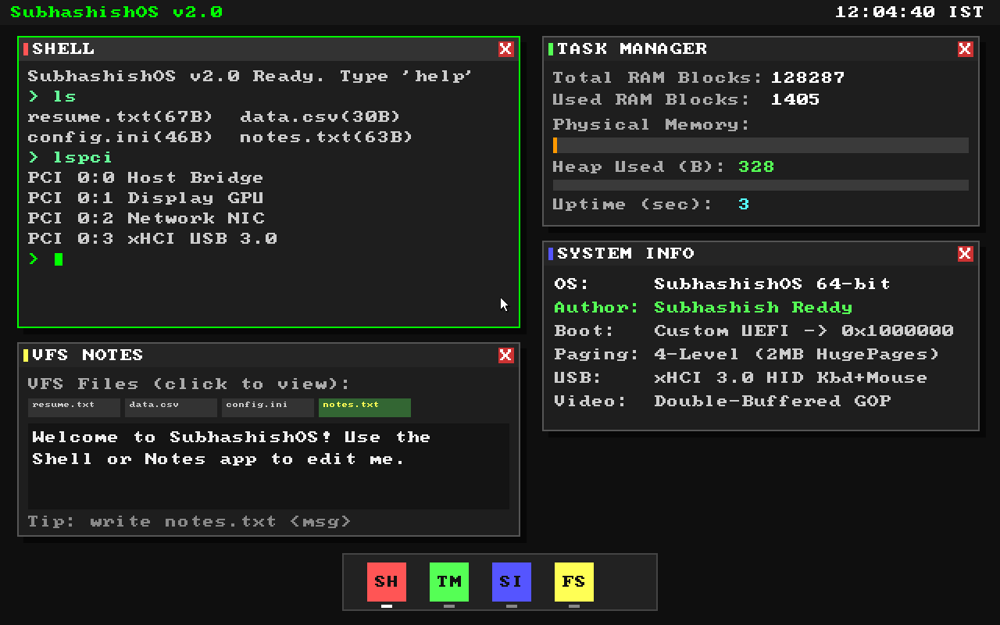

# Ash v2.0 — 64-Bit Bare-Metal Operating System

**Author:** Subhashish (Systems & Product Enthusiast)  
**Architecture:** `x86_64` Bare-Metal UEFI | **Stack:** C, x86_64 Assembly, Custom UEFI Bootloader, LLVM/Clang, QEMU



---

## Overview

**AshOS** is a custom 64-bit operating system engineered from first principles in C and x86_64 Assembly—with zero external libraries (`-ffreestanding -nodefaultlib`) and no underlying Linux/POSIX runtime.

It boots directly from UEFI firmware via a custom two-stage bootloader (`BOOTX64.EFI`), transitions out of UEFI Boot Services, establishes its own 64-bit Global Descriptor Table (GDT), Task State Segment (TSS), Interrupt Descriptor Table (IDT), 4-level page tables (2 MB Huge Pages), Physical Memory Manager (PMM), Kernel Heap (`kmalloc`/`kfree`), PCI bus enumerator, and a bare-metal **USB 3.0 (xHCI)** driver stack—all powering a 64-bit double-buffered graphical desktop environment.

---

## Key Features & Subsystems

### 1. Custom 2-Stage UEFI Bootloader (`su_bootloader/`)
- Queries the UEFI **Graphics Output Protocol (GOP)** for the physical framebuffer address, resolution, and scanline stride.
- Locates the **ACPI 2.0 RSDP / XSDT** hardware tables from the UEFI Configuration Table.
- Loads `kernel.bin` at `0x1000000` (16 MB physical base), harvests the UEFI Memory Map, verifies `ExitBootServices`, and transfers control to the kernel entry stub (`_start`) with a validated `BootInfo` contract.

### 2. CPU Tables, Fault Isolation & Crash Diagnostics (`start.c`, `gdt.c`, `idt.c`)
- **`_start` Bootstrap:** Zeroes `.bss` and switches off UEFI's temporary stack onto a dedicated, 16-byte-aligned **64 KB kernel stack**.
- **GDT & 64-Bit TSS:** Loads kernel code/data segments and a 64-bit TSS with **Interrupt Stack Table (IST1)** wired to a separate 16 KB Double-Fault stack so stack overflows never triple-fault the CPU.
- **32 CPU Exception Handlers:** Full register-saving assembly stubs dump `RIP`, `CR2`, `CR3`, `RSP`, `Error Code`, and general-purpose registers (`RAX`–`R15`) to both the COM1 serial log and an on-screen Kernel Panic screen.

### 3. Memory Management (`pmm.c`, `vmm.c`, `heap.c`)
- **Physical Memory Manager (PMM):** Parses the live UEFI memory map descriptors, protects the first 1 MB and the kernel image, and reclaims `EfiBootServicesCode`/`Data` once the kernel's own page tables are active.
- **Virtual Memory Manager (VMM):** Identity-maps `0–4 GB` using **2 MB Huge Pages** (~20 KB of page tables for instant boot) and dynamically splits 2 MB pages into 4 KB pages on demand when mapping uncacheable (`PCD | PWT`) MMIO regions.
- **Dynamic Kernel Heap:** First-fit `kmalloc` and coalescing `kfree` mapped at `0xFFFFC00000000000` with live byte-level telemetry.

### 4. Bare-Metal Hardware Drivers (`pci.c`, `xhci.c`, `acpi.c`, `apic.c`, `timer.c`, `rtc.c`)
- **USB 3.0 (xHCI) Host Controller & HID Stack:** Full command/event/transfer ring management (with proper Link TRB cycle-bit wrapping), root hub port reset, slot addressing, endpoint configuration (1 ms high-frequency polling), and dynamic HID classification for USB keyboards, relative mice, and 1:1 absolute USB tablets.
- **PCI Bus Enumerator:** Scans all 256 buses × 32 slots, enables PCI Bus Mastering/MMIO, configures Message Signaled Interrupts (MSI), and records discovered hardware for the `lspci` shell command.
- **PIT-Calibrated TSC Timer & CMOS RTC:** Calibrates the CPU `rdtsc` counter against PIT channel 2 at boot for hardware-independent millisecond timeouts (`mdelay`/`timer_ms`), paired with a cached CMOS RTC driver displaying live **IST (`+05:30`)** time.

### 5. Graphical Desktop Environment, Window Manager & Dynamic VFS (`video.c`, `gui.c`, `vfs.c`)
- **64-Bit QWORD Graphics Engine:** Stride-aware double-buffered renderer using `rep stosq` / `rep movsq` 64-bit transfers, up to 250 FPS input-driven redraws, window drop shadows, and a 12×19 arrow cursor sprite.
- **4-App Window Manager & Interactive Dock:**
  - **Shell (`SH`):** Multi-line word-wrapped scrollback terminal with blinking cursor (`ls`, `cat <file>`, `write <file> <text>`, `touch <file>`, `rm <file>`, `lspci`, `ps`, `mem`, `uptime`, `uname`, `sysinfo`, `notes`, `clear`, `help`).
  - **Task Manager (`TM`):** Live Physical RAM blocks, dynamic Kernel Heap usage (`B`), progress bars, and system uptime.
  - **System Info (`SI`):** Kernel architecture, bootloader handoff, paging mode, and driver overview.
  - **VFS Notes & File Explorer (`FS`):** Clickable file tabs inspecting live files stored in the heap-backed Virtual File System.

---

## System Architecture

```text
+-------------------------------------------------------------------+
|                        UEFI Firmware (OVMF)                       |
+---------------------------------+---------------------------------+
                                  |
                                  v
+-------------------------------------------------------------------+
|              Custom 2-Stage Bootloader (su_bootloader)            |
|   GOP Framebuffer + ACPI RSDP + UEFI Memory Map + ExitBootServices|
+---------------------------------+---------------------------------+
                                  |  BootInfo Struct (0x1000000)
                                  v
+-------------------------------------------------------------------+
|                   Kernel Bootstrap (start.c / kernel.c)           |
|       Zero .bss -> 64KB Kernel Stack -> GDT/TSS (IST1) -> IDT     |
+----------------+---------------------------------+----------------+
                 |                                 |
                 v                                 v
+--------------------------------+ +--------------------------------+
|       Memory Subsystem         | |      Hardware & Bus Layer      |
| - PMM (UEFI Map + Reclaim)     | | - ACPI XSDT/MADT & Local APIC  |
| - VMM (2MB HugePages + 4K Split| | - PCI Bus Scanner & MSI        |
| - Kernel Heap (kmalloc/kfree)  | | - USB 3.0 xHCI (Kbd + Tablet)  |
| - Heap-Backed Dynamic VFS      | | - PIT-Calibrated TSC & CMOS RTC|
+----------------+---------------+ +---------------+----------------+
                 |                                 |
                 +----------------+----------------+
                                  |
                                  v
+-------------------------------------------------------------------+
|           64-Bit Double-Buffered Desktop & Window Manager         |
|    Top Bar (IST Clock) | Shell | Task Manager | SysInfo | Notes   |
+-------------------------------------------------------------------+
```

---

## Quickstart (macOS / Linux)

### Prerequisites
```bash
brew install llvm nasm qemu
```

### Build & Run
```bash
chmod +x run.sh
./run.sh
```

### Try These Commands in the AshOS Shell
```text
help
ls
lspci
ps
mem
cat resume.txt
write notes.txt Built from scratch in C and x86_64 Assembly!
cat notes.txt
uptime
```

---

## Repository Structure

```text
AshOS/
├── dist/                    # Generated binaries and UEFI boot image
│   ├── kernel.bin           # Flat 64-bit OS kernel binary (linked at 16MB)
│   └── EFI/BOOT/BOOTX64.EFI # UEFI bootloader application
├── src/stage1/              # Core kernel source files
│   ├── start.c              # Assembly bootstrap (.bss zeroing & 64KB stack setup)
│   ├── kernel.c             # Core kernel initialization and event loop
│   ├── gdt.c                # Kernel GDT & TSS (with Double-Fault IST stack)
│   ├── idt.c                # 32 CPU exception handlers & crash dump diagnostics
│   ├── timer.c              # PIT-calibrated TSC hardware timer & bounded delays
│   ├── pmm.c                # UEFI Memory Map-driven Physical Memory Manager
│   ├── vmm.c                # 4-level paging with 2MB huge-page identity mapping
│   ├── heap.c               # Dynamic kernel heap (kmalloc / kfree)
│   ├── acpi.c               # ACPI XSDT & MADT table parser
│   ├── apic.c               # Local APIC controller driver
│   ├── pci.c                # PCI bus enumerator & MSI configuration
│   ├── xhci.c               # USB 3.0 xHCI driver (HID keyboard, mouse & tablet)
│   ├── video.c              # 64-bit QWORD double-buffered graphics engine
│   ├── gui.c                # 4-app Window manager, Dock, and interactive shell
│   ├── vfs.c                # Heap-backed in-memory Virtual File System
│   ├── rtc.c                # Cached CMOS Real-Time Clock driver (IST timezone)
│   ├── lib.c                # Freestanding memory and string utilities
│   ├── kernel.ld            # Kernel linker script (0x1000000 base)
│   └── *.h                  # Subsystem headers and shared BootInfo contract
├── su_bootloader/           # Custom 2-stage UEFI bootloader
│   ├── boot.c               # UEFI entry point shim
│   ├── payload.c            # GOP, ACPI, Memory Map & ExitBootServices loader
│   ├── payload_data.s       # Embedded payload binary wrapper
│   └── linker.ld            # Payload linker script
├── run.sh                   # Build and QEMU execution script
├── screenshot.png           # Runtime v2.0 GUI screenshot
├── PORTFOLIO.md             # Engineering case study & interview notes
└── README.md                # Project documentation
```

